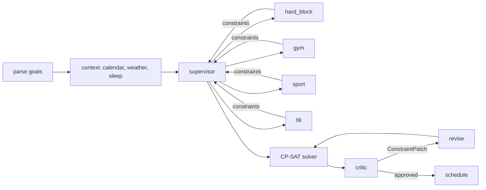

# Agentic Scheduler

Tell it your week in plain English — *"gym 3x, tennis twice, 20 hours on my side project"* — and it builds a conflict-free weekly schedule around your real calendar and the weather, then writes it to Google Calendar after you approve it.

<!-- Drop a UI screenshot or GIF here, e.g.:

A short screen recording of typing goals → watching the week solve itself works even better. -->

## How it works: LLM agents + a constraint solver

Most LLM schedulers ask the model to place events directly — and the model double-books, forgets pins, or silently drops sessions. This project splits the job:

- **LLMs interpret intent.** A LangGraph multi-agent pipeline parses goals, reads context (calendar, weather, sleep), and emits a **typed constraint vocabulary** ([`scheduler/solver/constraints.py`](scheduler/solver/constraints.py)): activity requests, hard exclusions, soft preferences. The LLM never places an event.
- **CP-SAT places events.** Google OR-Tools ([`scheduler/solver/cpsat.py`](scheduler/solver/cpsat.py)) solves the whole week globally on a 30-minute grid. Overlaps are impossible by construction, day pins and quotas are hard constraints, and anything that genuinely can't fit is reported honestly instead of dropped.
- **A critic closes the loop.** An LLM reviews the solved schedule against the original goals; its feedback becomes a `ConstraintPatch`, and the solver re-solves. User change requests ("add two gym sessions at noon or later, tennis on back-to-back days") flow through the same patch → re-solve mechanism.



## Features

- **Web UI** — propose → confirm → adjust loop on a rolling 7-day grid that always starts today; nothing touches your calendar until you approve.
- **Natural-language change requests** — "make the tennis sessions back to back" edits the constraint set and re-solves the whole week, so a change never introduces a conflict.
- **Context-aware** — existing calendar events become hard exclusions; storms block outdoor sports on pinned days or steer them elsewhere; heat and rain become soft penalties.
- **Honest infeasibility** — if 3 sessions can't fit, you're told "only 2 of 3 fit" and why, instead of getting a quietly broken week.
- **Timezone-correct** — dates resolve in *your* timezone (`SCHEDULER_TZ`), not the server's, so a UTC host doesn't shift your evening requests a day ahead.
- **Observability** — set the LangSmith env vars and every graph run, agent decision, and LLM call is traced.

## Data sources

| Source | Used for | Without a key |
|---|---|---|
| Google Calendar | Hard events in, approved schedule out | Mock week |
| OpenWeatherMap | Outdoor-sport exclusions & preferences | Mock forecast |
| Oura | Sleep scores → intensity preferences | Mock scores |
| Anthropic (Claude) | Goal parsing, preference tuning, critic, change patches | Deterministic fallbacks (parsing requires a key) |

## Quickstart

```bash
python -m venv .venv && source .venv/bin/activate   # Windows: .venv\Scripts\activate
pip install -r requirements.txt
cp .env.example .env    # set ANTHROPIC_API_KEY; everything else is optional
uvicorn web.app:app --reload
```

Open http://localhost:8000, type your weekly goals, and review the proposal. `python main.py` runs the same pipeline as a CLI.

Only `ANTHROPIC_API_KEY` is required — every other integration degrades gracefully to mock data, so the solver and UI are fully explorable offline.

## Testing

```bash
pip install -r requirements-dev.txt
pytest tests/ -q
```

The suite is hermetic: graph tests run with `llm=None` (deterministic agent fallbacks) and injectable parse/patch functions, so CI needs no API keys. A separate LLM-gated eval suite (`tests/test_goal_parser_evals.py`) exercises real goal parsing when `ANTHROPIC_API_KEY` is set. GitHub Actions runs the hermetic suite on every push.

## Deployment

[`render.yaml`](render.yaml) deploys the web app to Render. Set the env vars from [`.env.example`](.env.example) in the dashboard — in particular `SCHEDULER_TZ` (Render runs UTC) and the Google credential/token JSON blobs for calendar access.

## Project layout

```
scheduler/
  graph/       LangGraph pipeline: nodes, critic/revise loop, change-request patches
  solver/      Constraint vocabulary (Pydantic) + OR-Tools CP-SAT core
  llm/         Goal parser (structured output) and pipeline entry
  data/        Providers (Google Calendar, weather, sleep) with mock fallbacks
web/           FastAPI app + single-file frontend
tests/         Hermetic solver/graph/web tests + LLM-gated evals
```
